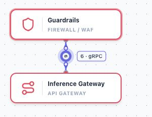
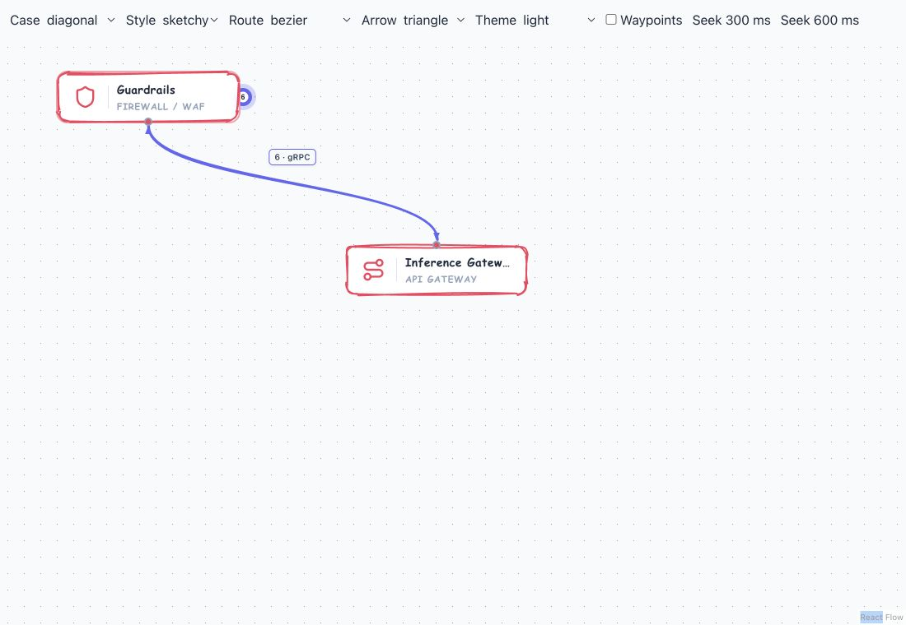
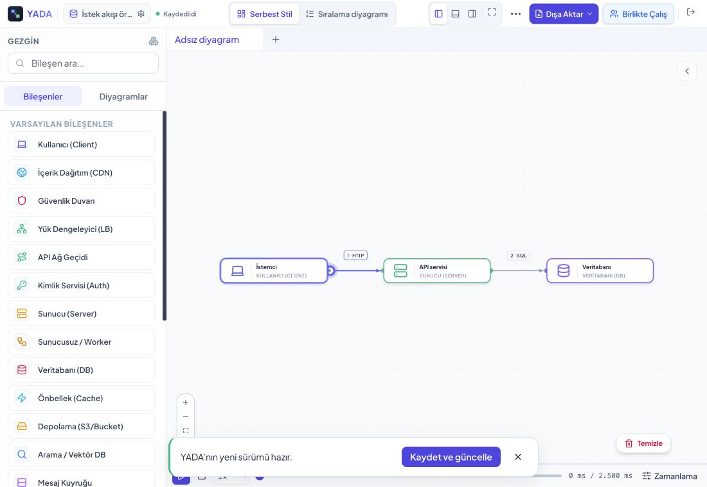

# Bağlantı görünümü: ilk paket

17 Ekim 2026. Amaç: seçili/aktif bağlantılarda yönü, etiketi ve düzenleme noktalarını ayırt edilebilir hale getirmek; rota, port, zamanlama ve simülasyon semantiğini korumak.

## Değişiklikler

- React Flow yeniden bağlama alanları 12 yarıçapla görünmez kalır. 3,5 yarıçaplı ayrı görsel işaretler aynı dışa ötelenmiş merkezleri gösterir; etkileşim native React Flow üzerinden devam eder. Export'ta düzenleme işaretleri hariçtir.
- Ok viewport'u normal 2 birim çizgide 12,5 × 10; glyph yaklaşık 10 × 7,5 birim. Temel çizgi çok kalınsa ölçeklenir, aktiflikte büyümez. Marker referansı her şeklin gerçek ucudur (üçgen/açık/baklava/daire). Başlangıç ve bitiş ayrı desteklenir.
- Oklar `userSpaceOnUse` ve `orient=auto` kullanarak gerçek geometrik rota üzerinde çizilir. Dekoratif Rough.js yolu marker taşımaz. Böylece eskizde birden çok alt yolun ayrı ok çizmesi ve dekoratif son teğetin yönü bozması engellenir. Rota ve animasyonun ölçtüğü yol değiştirilmedi.
- Etiket anchor'u kullanıcının yol yüzdesini korur. Teğete göre sağ/sol veya üst/alt adaylar, uç node sınırlarıyla karşılaştırılır. Trafik koridorunda 22 birim boşluk bırakılır. Kartla çakışmayan en yakın aday seçilir. Tüm diyagramdaki her node/etiket arasında küresel çakışmazlık garantisi verilmez.
- Tipografi 10 birim / 600, nötr tema yüzeyi ve ince aktif kenarlık kullanır. `6 · gRPC` biçimi; uzun metin en çok 180 birim, tam içerik tooltip'te. Protokoller kullanıcı verisidir; hızlı düzenleme açıklamaları mevcut TR/EN kataloğundan gelir.
- Yaygın tek kübik bağlantılarda etiket açısı/konumu mevcut JS yol örnekleyicisinden hesaplanır; her karede SVG ölçümü yapılmaz. Çok parçalı rotada ölçüm yalnızca geometri/içerik boyutu değişince yapılır. Büyük diyagram performans kabulü çalıştırılmadı.
- Seçili bağlantıda ara noktalar mevcut sürükleme/çift tık davranışını korur. Kısa bağlantıda tek orta ekleme işareti; uzunlarda iki işaret bulunur. Görünmez tutamaçlar seçilmemiş bağlantının ilk tıklamasını yakalamaz.

## Simülasyon koruması

Protokol hızlı düzenlemesinin mevcut bir hatası tespit edildi: verilmemiş iç işlem parametresi iç işlemi kaldırıyordu. Artık `undefined` mevcut değeri korur; açık boş metin kaldırır. Sıfır işlem süresi 1000'e dönüştürülmez. Bu davranış, geçmiş ve takvim eşitliğiyle test edilir. Gerçek UI örneğinde HTTP → gRPC değişiminden sonra toplam süre 2.500 ms kaldı.

## Kanıt

- **54 test dosyası / 332 test başarılı.** Marker katmanı iki görünümde tek geometrik yol üzerindedir; seçili durumda boyut sabittir. Yerel yerleşim/uç referansları, geçmiş ve zamanlama koruması için regresyon testleri vardır.
- Web, Forge ve Data Center derlemeleri başarılı. Mevcut büyük isteğe bağlı paket uyarıları sürer. Native derleme bu ön yüz paketinde yeniden çalıştırılmadı.
- [Geometri matrisi](edge-rendering-matrix.json): temiz/eskiz × kısa dikey/çapraz/yatay/ters/self-loop = 10 durumda uç kartlarla etiket kesişimi 0. Ayrıca dört ara noktalı rota ve beş ok seçeneği kaydedildi.
- [Altı tema](edge-themes.json): etiketler açık/koyu tema tokenlarını ve okunabilir nötr ön planı kullanır; özel bağlantı rengi metnin kontrastını belirlemez.
- Gerçek YADA renderer, portları, store'u ve scheduler'ı kullanan [yerel kabul ekranı](edge-rendering.html), `npm run dev` ile açılabilir. Test ekranı üretim uygulamasının giriş noktası değildir.
- Yeniden bağlama: kısa dikey hedef tutamacı üst porttan sol porta sürüklendi. Yol sonu `270,180` → `155,215`; ok yeni rotayı izledi.
- Ara nokta: yatay çizginin ekleme noktası 60 birim sürüklendi; yol iki kübik parçaya ayrıldı. Noktaya çift tıklanınca eski tek kübik rota geri geldi.
- Gerçek uygulamada seçili etiketin çift tık düzenlemesiyle gRPC kaydedildi. %50 → %25 konumunda x anchor 282 → 255,5; eski yanal boşluk korundu. Oynatmada parçacık transform'u ilerledi; düzenleme noktaları gizlendi; ok viewport'u sabit kaldı.
- [Mobil TR/EN](edge-mobile-languages.json): 360 px, taşma yok, açıklama iki dilde. Masaüstü 1100 px. Fiziksel cihaz kabulü yapılmadı.
- [Son üretim kontrolü](edge-production.json): iki bağlantıda iki ok katmanı, sabit boyut, TR tooltip'ler ve yatay taşma olmaması doğrulandı.

Node ve parçacık görsel tasarımı bir sonraki paketin konusu olabilir. Büyük diyagram simülasyonu ve ekran okuyucu kabulü kapsam dışıdır.
