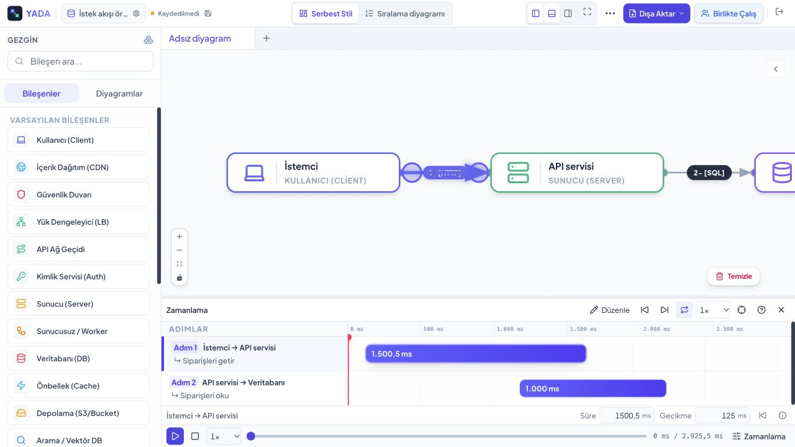
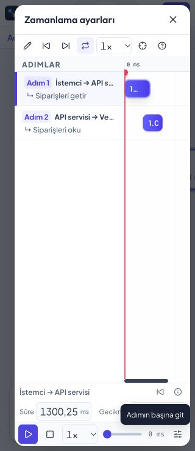
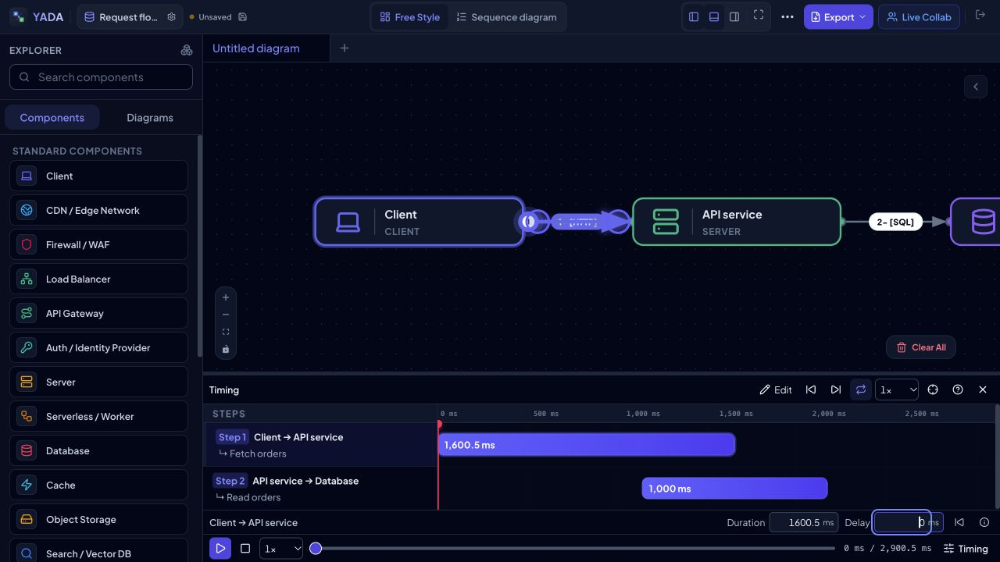

# Timeline: doğrudan süre ve gecikme düzenleme

17 Ekim 2026. Gelişmiş zamanlama panelinin isteğe bağlı, kapalı başlangıcı korundu.

## Davranış

- Bir adım seçilince mevcut detay satırında iki sayısal alan görünür. Sürükleme için Düzenle anahtarı gereklidir; sayısal giriş için ek mod açılmaz.
- Enter veya odaktan çıkma uygular. Başka adımın pointerdown ile seçilmesi öncesinde aktif alan odaktan çıkarılarak taslağın kaybolması engellenir. Escape son kayıtlı değeri geri yükler ve mobil paneli kapatmaz.
- Yazarken store/geçmiş/zamanlama değişmez. Her başarılı alan onayı bir undo noktasıdır; değişmeyen değerler geçmiş oluşturmaz. Undo/redo çizelgeyi yeniden hesaplar.
- Virgül/nokta ondalıkları ve sıfır kabul edilir; sonlu olmayan/negatif/boş/karışık ayraçlı giriş reddedilir. TR virgül, EN nokta gösterir; gruplama ayıracı kullanılmaz.
- Aynı alanın eşzamanlı değişimi veya belge değişimi eski taslağı engeller. Diğer alanın güncel değeri birleştirilir; iç işlem ve animasyon metadata'sı korunur.
- Oynatma sırasında girişler kilitlenir. Salt okunur belgeler yalnızca biçimlenmiş değerleri gösterir. Bilgi düğmesi iç işlem gibi ayrıntılar için mevcut modalı açar.

## Yerleşim

Mevcut tema tokenları, ince kenarlık ve sekmeli rakamlar kullanıldı. Masaüstünde girişler 26 px, seçim satırı 31 px; oynatma şeridi 36 px. Mobilde ad ve iki eylem ilk satırda, iki alan ikinci satırda; seçim alanı 64 px. 16 px mobil giriş yazısı ve 30 px giriş yüksekliği korundu. Hata yalnızca gerektiğinde alanın üstünde görünür; sabit açıklama/uygulama butonu eklenmedi.

## Kontroller

- 51 dosyada 315 test başarılı: yerelleştirme kapsamı, geçersiz değerler, iki dilde ondalık/sıfır/küçük kesirler, undo/redo, değişmeyen değer, eşzamanlı değişim, belge sahipliği ve oynatma/salt okunur korumaları.
- Web, Forge ve Data Center üretim derlemeleri başarılı. Önceden var olan büyük isteğe bağlı paket uyarıları sürüyor.
- Yerel tarayıcıda TR Light ve EN Dark; 1280 px masaüstü ve 320 px mobil emülasyon. Seçim satırları/alanlar yatay taşmıyor. Fiziksel cihaz kullanılmadı.
- Gerçek UI: 1200 → 1450,5 ms Enter; gecikme 75,25 blur; Escape eski değere dönüş; iki ardışık undo 75,25 → 0 ve 1450,5 → 1200; oynatmada iki alan disabled. Mobil Escape paneli açık tutuyor.
- Son üretim çıktısı: süre 1500,5, gecikme 125. Gecikme yazılıyken Adım 2'ye tıklayıp Adım 1'e dönüldüğünde 125 korunuyor. 999 taslağına Escape ardından adım değişiminde 125 korunuyor. Masaüstünde açık modal sayısı 0. Ölçüler [kabul kaydı](timeline-inline-acceptance.json).

Büyük diyagram simülasyonu ve ekran okuyucu kabulü kapsam dışıdır. Tauri native derlemesi bu yalnızca ön yüz değişikliğinde yeniden çalıştırılmadı.
