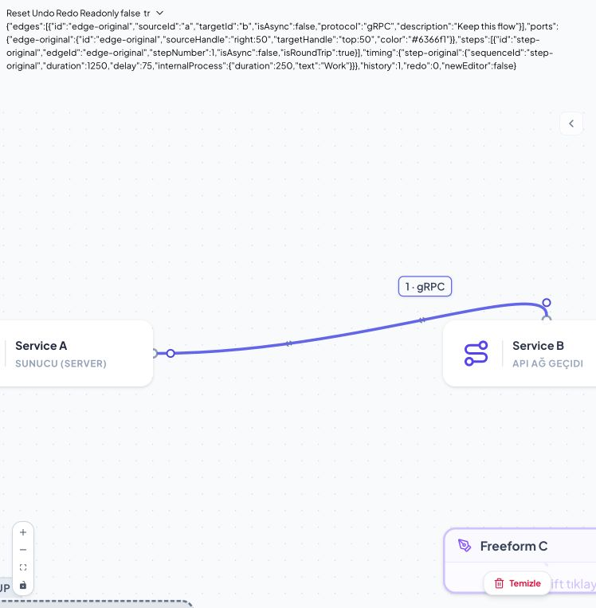

# Connector taşıma kabulü — 18 Ekim 2026

Mevcut edge'in kaynak veya hedef ucunu başka connector'a taşıma düzeltildi. Edge kimliği, bağlı simülasyon adımları, süre/gecikme, iç işlem, protokol ve görünüm verileri korunur.

## Nedenler ve düzeltmeler

- React Flow yeniden bağlamada da `onConnectEnd` çağırır. Node gövdesine bırakıldığında çalışan yeni bağlantı fallback'i bu hareketi yeni edge olarak yorumluyordu. Yeniden bağlama hareketi artık ayrı izlenir; başarıda da iptalde de yeni edge/adım oluşturmaz.
- React Flow yardımcı fonksiyonunun varsayılanı edge kimliğini değiştiriyordu. `shouldReplaceId: false` ile yerel renderer ve kalıcı belge aynı kimliği kullanır. Gecikmeli eşitleme seçimi korur.
- Kaynak uç taşınırken kaynak connector'lara bırakmak gerekir. Önceki CSS tüm kaynak connector'ları devre dışı bırakıyordu. BaseNode ve FreeFormNode artık hareketin yönüne göre doğru katmanı açar. Gizli hedef hit alanını görünür connector'dan kaydıran negatif margin kaldırıldı.
- Aynı connector'a bırakmak ve bulunmayan edge'i güncellemek geçmiş kaydı oluşturmaz. Geçerli değişiklik tek geri alma adımıdır.

## Gerçek arayüz kabulü

`reconnect.html` tam ürün `DiagramCanvas` bileşenini kullanır. Kontroller ekrandaki Document state çıktısından okunmuştur; tarayıcı deposu doğrudan değiştirilmemiştir.

| Senaryo | Sonuç |
| --- | --- |
| Kaynak ve hedefi üst/sağ/alt/sol portlara art arda taşıma | 8 hareket boyunca 1 edge, 1 adım; kimlik sabit |
| Hedefi aynı node'un üst connector'ına taşıma | `targetHandle: top:50`; geçmiş 1; yeni düzenleme modalı açılmaz |
| Aynı connector'a bırakma | Değişiklik ve ek geçmiş kaydı yok |
| Boş alana / geçersiz grup hedefine bırakma | Eski bağlantı korunur, çoğalma yok |
| Freeform kaynak ve hedef portlarına taşıma | İki yönde başarılı |
| Geri alma / yeniden uygulama | Eski/yeni port geri gelir; metadata ve zamanlama korunur |
| İptalden sonra normal yeni bağlantı oluşturma | Normal şekilde ikinci edge ve ikinci adım oluşur |
| Salt okunur görünüm | Yeniden bağlama uçları yok |
| TR ve EN | Yerelleştirilmiş kontroller çalışır; ürün metni eklenmedi |

Son örneğin belge çıktısı: [reconnect-final-state.json](reconnect-final-state.json). Süre 1250 ms, gecikme 75 ms, iç işlem 250 ms ve gRPC protokolü aynı kaldı.

Otomatik regresyon kapsamı: connector katmanlarının iki yönde açılması, BaseNode/FreeFormNode hizası, edge/adım kimliği, metadata, tek geçmiş kaydı, geri alma/yeniden uygulama ve no-op güncellemeler. Son tam test çalışması: **66 dosya, 379 test başarılı**. Web, Forge, Data Center ve macOS Tauri debug uygulaması derlemeleri başarılı. Tarayıcı kabulü uygulama içi tarayıcıda yapıldı; fiziksel dokunmatik cihazda sürükleme kabulü yapılmadı. Büyük diyagram simülasyonu kapsam dışıdır.
