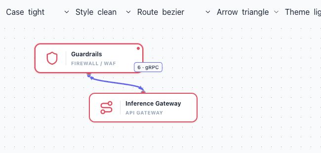

# Eğri uçlarında ok hizası — 19 Ekim 2026

Keskin bir Bézier dönüşünde SVG `orient="auto"` tam bitiş noktasının teğetini izliyordu. Bu teğet dik olsa da okun gövdesinin kapladığı bölüm diyagonal olabiliyor; ok çizgiden ayrılmış görünüyordu.

Başlangıç/bitiş oku artık kendi uzunluğunun kapladığı rota bölümünün geliş açısını kullanır. Uç referansı connector'da kalır. Rota, bağlantı verileri, sürükleme alanları ve parçacık yolu değiştirilmedi. Açı, rota/ok ölçüsü değişince layout aşamasında güncellenir; animasyon kare döngüsüne iş eklenmez. Yakalanan SVG/HTML/video DOM'u aynı marker açısını taşır. Yeni ürün metni yok; TR/EN etkilenmez.

Gerçek renderer kabulünde kısa keskin eğri yaklaşık **39,81°** ile hizalandı; önceki otomatik uç teğeti 90° idi. Temiz/eskiz görünümü, iki uç, yatay/ters/diyagonal/self-loop ve Bézier/düz/köşeli rotalar incelendi. `arrow-angles.json` ham DOM ölçümleridir; loop/smoothstep satırındaki boş liste geçiş anında okunmuştur, kabul kanıtı olarak kullanılmaz. Diğer self-loop rotaları aynı loop geometrisini kullanır.

Otomatik regresyon: eğri üzerinde ok uzunluğu kadar örnekleme, ters düz rota, kısa ve sıfır uzunlukta sonlu açı. **66 dosyada 383 test ve web üretim derlemesi başarılı.** Bu değişiklik için native/Safari uygulama kabulü tekrarlanmadı. Büyük diyagram simülasyonu kapsam dışıdır.

